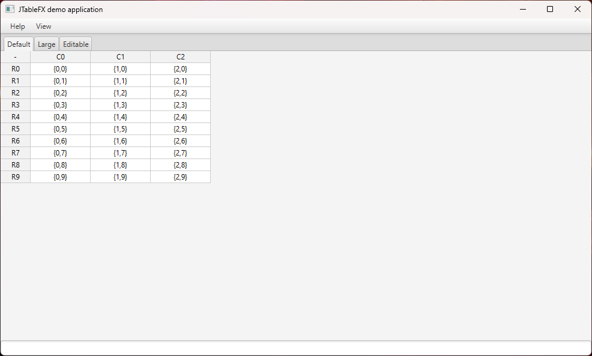
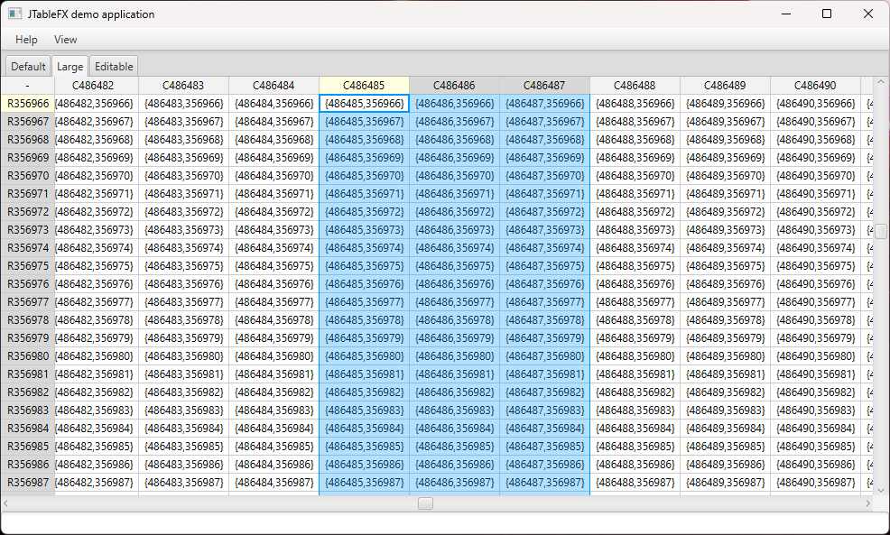
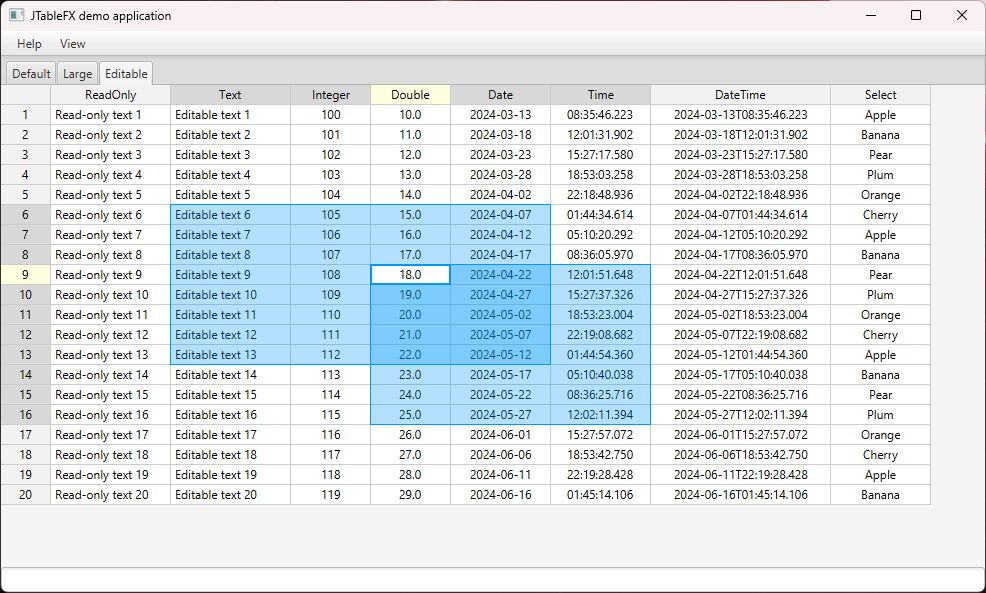
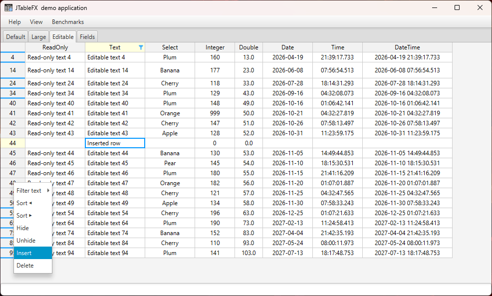
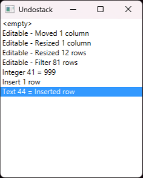

# JTableFX

JTableFX is an open-source JavaFX library for building high-performance, spreadsheet-style table views with rich interaction and editable data operations. It is designed for desktop applications that need more than a basic table widget, with support for undoable editing, resizing, reordering, hiding & unhiding, sorting, filtering, inserting and deleting rows and columns.

[](https://www.gnu.org/licenses/gpl-3.0)
[](https://github.com/dazzle50/JTableFX/releases)
[](https://deepwiki.com/dazzle50/JTableFX)
[](https://x.com/JTableFX)

## Why JTableFX?

JTableFX is intended for applications that need spreadsheet-style behaviour inside a JavaFX UI. It focuses on editable grid data, rich row and column operations, undoable changes, and responsive handling of larger datasets.

## Features

- **Spreadsheet-style table interaction**
  - Cell, row, and column selection
  - Mouse and keyboard navigation
  - Zoom support (`Ctrl +/-/0`)

- **Editable and undoable table operations**
  - Built-in support for multiple cell value types with specialised editors
  - Resize, reorder, hide, unhide, sort, and filter rows and columns
  - Insert, delete, and append table data
  - Undo/redo framework supporting all operations

- **Performance-oriented design**
  - Efficient rendering and interaction for larger datasets
  - Responsive handling of slower operations
  - Optimised internal index, mapping, and layout behaviour

- **Extensible architecture**
  - Model-view-controller design supporting multiple views from single data sources
  - Flexible APIs for integrating custom data models and behaviours
  - Utility classes including date, time, and datetime handling and parsing
  - Reusable input controls, including date/time fields, choice dropdowns, and number spinners

## Demo Application

The demo application showcases JTableFX in a range of scenarios, including standard table usage, larger datasets, editable data, and undo/redo support.

### Default table


### Large dataset view


### Editable table example




### Undo stack window


## Getting Started

### Requirements

- **Java 25+** (a JDK is needed to build the source).
- **JavaFX 25+** either bundled with your JDK or installed separately.

A JDK with bundled JavaFX can simplify setup, such as [Azul Zulu builds](https://www.azul.com/downloads/?package=jdk-fx) with JavaFX included.

### Running the demo from the command line

Download a runnable JAR from the [Releases](https://github.com/dazzle50/JTableFX/releases) page. Replace `JTableFX.jar` below with the downloaded filename.

If your Java runtime includes JavaFX:

```text
java -jar JTableFX.jar
```

If your Java runtime does not include JavaFX, supply the JavaFX module path:

Windows Command Prompt (`PATH_TO_FX` must point to the JavaFX SDK's `lib` directory):

```bat
java --module-path "%PATH_TO_FX%" --add-modules=javafx.controls -jar JTableFX.jar
```

PowerShell:

```powershell
java --module-path "$env:PATH_TO_FX" --add-modules=javafx.controls -jar JTableFX.jar
```

Linux/macOS:

```sh
java --module-path "$PATH_TO_FX" --add-modules=javafx.controls -jar JTableFX.jar
```

See the [OpenJFX setup guide](https://openjfx.io/openjfx-docs/) for platform-specific JavaFX configuration.

### Eclipse setup

The repository contains an Eclipse project; it does not include a Maven or Gradle build.

1. Install a JDK 25 or newer and use an Eclipse version that supports it.
2. Clone or download this repository, then use `File -> Import -> General -> Existing Projects into Workspace` and select the repository directory.
3. Select your JDK in the project's *Java Build Path* and set its *Java Compiler* compliance level to 25 or newer.
4. If your JDK does not bundle JavaFX, download a compatible JavaFX SDK from [Gluon](https://gluonhq.com/products/javafx/), then:
   - Create a *User Library* via `Window -> Preferences -> Java -> Build Path -> User Libraries -> New`.
   - Add the JARs from the SDK's `lib` folder.
   - Add that library to the project's *Modulepath* via `Project -> Properties -> Java Build Path -> Libraries -> Add Library`.
5. Run `rjc.table.demo.Demo` as a Java application.

When building or packaging outside Eclipse, copy the PNG resources under `src` to the corresponding package directories alongside the compiled classes. The demo icon and table cursors load these resources at runtime. A runnable JAR needs `rjc.table.demo.Demo` as its main class.

### Running from Windows Explorer

For easier launching of JavaFX JAR files from Windows, you can use the provided [run_javafx.cmd](run_javafx.cmd) helper script.

1. Create an environment variable named `PATH_TO_FX` pointing to the JavaFX SDK `lib` directory.
2. Ensure `java` on your `PATH` is the intended runtime.
3. Place `run_javafx.cmd` in a suitable location and associate `.jar` files with it, ensuring the JAR filename is passed as a quoted argument so paths containing spaces work.

Double-clicking a runnable JAR should then open a command window and launch the JavaFX application. The helper requires `PATH_TO_FX` even when your JDK bundles JavaFX, and it pauses after the application exits. Changing the `.jar` association affects other JAR files too.

## Using JTableFX in your application

For a classpath-based JavaFX application, add the compiled JTableFX classes or JAR to your application's classpath, with JavaFX available as described above.

For a modular application, put JTableFX and JavaFX on the module path and add `requires JTableFX` to your module descriptor. For example, if your JavaFX `Application` subclass is in package `my.application`:

```java
module my.application
{
  requires JTableFX;

  exports my.application to javafx.graphics;
}
```

Use your own module and package names. The qualified export allows JavaFX to construct your application. JTableFX transitively requires `javafx.base`, `javafx.graphics`, and `javafx.controls`, making their exported APIs available to your module too.

The [JTableFX module descriptor](src/module-info.java) exports the table models and views, rendering and editing extension points, controls and dropdowns, selection and axis APIs, actions, undo commands, signals, and date/time types. Cursor implementations and keyboard handlers remain internal. These exports apply to builds of the current source; older release JARs may expose fewer packages.

With either setup, inside your JavaFX application's `start(Stage stage)` method, a minimal table is:

```java
var data = new rjc.table.data.TableData();
data.setColumnCount( 5 );
data.setRowCount( 100 );

var view = new rjc.table.view.TableView( data, "Example" );
stage.setScene( new javafx.scene.Scene( view, 800, 600 ) );
stage.show();
```

This displays generated placeholder values. For real data:

- Extend `TableData` and override `getValue(int dataColumn, int dataRow)`. Body indices start at `0`; `TableData.HEADER` (`-1`) identifies header cells.
- For editable cells, override the protected `setValue(int dataColumn, int dataRow, Object newValue, boolean commit)` method. Validate without changing data when `commit` is `false`; return `null` on success or an error message on rejection. Also extend `TableView` and override `getCellEditor(CellDrawer cell)` to supply an editor for each editable cell. See [EditableTableData](src/rjc/table/demo/edit/EditableTableData.java) and [EditableTableView](src/rjc/table/demo/edit/EditableTableView.java).
- Implement `IDataInsertDeleteRows` and/or `IDataInsertDeleteColumns` to support insertion, deletion, and appending. Implement `IDataSwapRows` and/or `IDataSwapColumns` to support reordering and sorting the underlying data; otherwise these operations change the view's index mapping.
- Use the model's change signals when updating data outside its public `setValue` method, so attached views refresh. Make UI changes and emit model change signals on the JavaFX Application Thread. Sorting reads model values and comparators on a background thread, so avoid concurrent model changes during sorting.
- Views create their own undo stack by default. Use `view.setUndostack(sharedStack)` to share a stack. Direct model changes do not automatically become undoable; use undo commands for changes that need undo/redo.

## License

Source headers specify **GNU GPL v3 or later**. See [LICENSE](LICENSE) for the licence text.

## Built with

* [Java](https://en.wikipedia.org/wiki/Java_(programming_language)) - General-purpose computer programming language
* [JavaFX](https://en.wikipedia.org/wiki/JavaFX)  - Java software library used to generate the application's interactive graphical user interface
* [Eclipse](https://en.wikipedia.org/wiki/Eclipse_(software)) - Integrated development environment (IDE) used to develop the project
